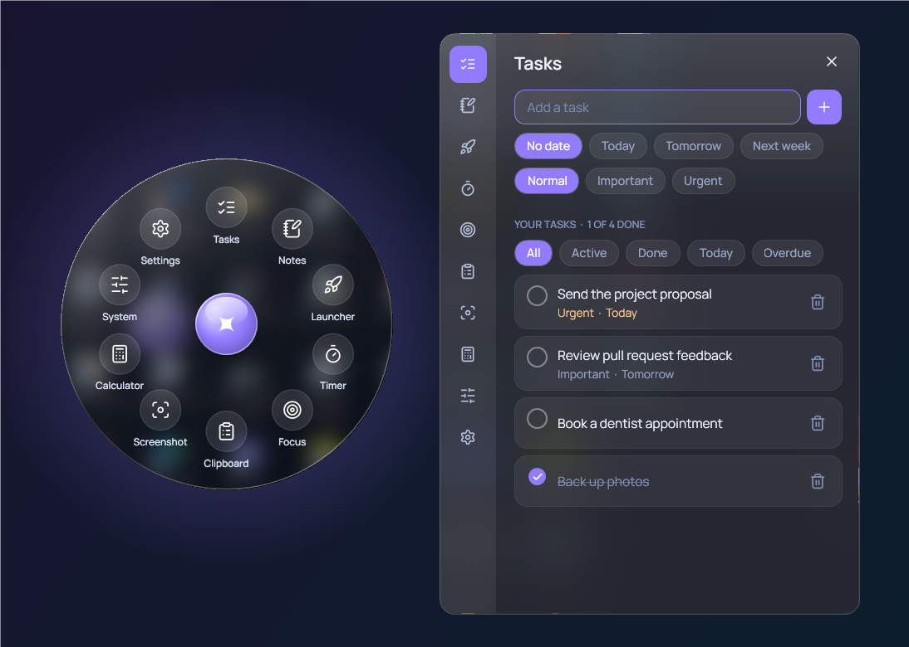

<div align="center">


# Floatly

**A floating glass button for Windows that puts ten everyday tools one click away.**

Tasks · Notes · Launcher · Timer · Focus · Clipboard · Screenshot · Calculator · System · Settings




</div>

## What it is

Floatly sits at the edge of your screen as a small liquid-glass button. Click it and all ten tools fan out around it in one ring. Pick one and a compact glass panel opens beside the button. There are no pages to flip through and no account to create, and nothing leaves your PC.

## Features

| Tool | What you can do |
|---|---|
| **Tasks** | Add with Enter, pick a due date and priority with one tap, filter by Active, Done, Today or Overdue |
| **Notes** | A searchable list of notes; open one to write, and it saves as you type |
| **Launcher** | Open Notepad, Explorer, Paint or Task Manager, or pin your own apps, files, folders and links |
| **Timer** | Countdown with 1, 5, 15, 30 and 60 minute presets, plus a stopwatch; keeps running when the panel is hidden |
| **Focus** | Work and break sessions with your own lengths, a desktop notification at the end, and a session count |
| **Clipboard** | Save copied text on demand, or let it collect what you copy for the current session (off by default) |
| **Screenshot** | Capture a selected area, one screen or all screens to `Pictures\Floatly Captures` |
| **Calculator** | Keypad or keyboard input with proper operator order and brackets, plus your last results |
| **System** | Volume and mute, plus shortcuts to Wi-Fi, Bluetooth, Display, Night light, Sound and Power settings |
| **Settings** | Accent colour, button size and opacity, reduce motion, start with Windows, hotkey, backup export |

**Around the tools**

- Drag the button anywhere; it snaps to the nearest screen edge and remembers its place, on any monitor.
- Press **Ctrl + Alt + Space** from any app to open the ring.
- Right-click the button, or use the tray icon, to hide it, open Settings or exit.
- Only one copy runs at a time, and it is always on top of ordinary windows.

## Design

- **Liquid glass.** The button is a lit glass orb that stretches when you press it, springs back with a small wobble, and has a highlight that drifts across it while you hover. The ring is a frosted disc that blurs whatever is behind it.
- **One step to any tool.** All ten tools sit on a single ring, and the panel has an icon rail, so switching tools is always one click.
- **Quiet panel.** On Windows 11 the panel uses the system's acrylic blur; Windows 10 gets the same layout on a solid dark surface. Messages appear as small notices inside the panel instead of pop-up dialogs, and deleting something asks for a second click.
- **Type and icons.** Text is set in [Manrope](https://github.com/googlefonts/manrope) and icons are from [Lucide](https://lucide.dev), drawn as vectors so they stay sharp at any display scaling.
- **Reduce motion** in Settings turns off every animation.

## Get started

You need Windows 10 or 11 (64-bit) and the free [.NET 10 SDK](https://dotnet.microsoft.com/download/dotnet/10.0).

```powershell
git clone https://github.com/ohenemanaf/floatly.git
cd floatly
dotnet run --project .\Floatly.App\Floatly.App.csproj
```

Or double-click the scripts in the project folder:

| Script | What it does |
|---|---|
| `01-BUILD-AND-RUN.bat` | Builds Floatly and starts it |
| `02-CREATE-PORTABLE-EXE.bat` | Builds a single self-contained `Floatly.exe` (about 72 MB) in `out\Floatly-win-x64`; the other PC does not need .NET installed |
| `03-RUN-LOGIC-TESTS.bat` | Runs the calculator, storage and timer checks |
| `04-INSTALL-LOCALLY.bat` | Copies the portable build to your user Apps folder and adds a Start menu shortcut (no admin rights needed) |
| `05-UNINSTALL-LOCAL.bat` | Removes that install and its startup entry; your notes and tasks are kept |

**Start with Windows** only works from the published `.exe`, not from a debug build. Run `02` and `04` first, then switch it on in Settings.

## Install on another PC

Floatly is not code-signed, so Windows treats a downloaded copy as an unknown app. To set it up on someone else's PC, zip the `out\Floatly-win-x64` folder, send it, and have them:

1. Right-click the downloaded zip, choose **Properties**, tick **Unblock**, then **OK**. Do this before extracting; it removes the "downloaded from the internet" mark that triggers most warnings.
2. Extract the zip and double-click `Floatly.exe`.
3. If a blue **Windows protected your PC** screen appears, click **More info**, then **Run anyway**.
4. Only if **Smart App Control** still blocks it: open Windows Security, go to App & browser control, then Smart App Control, and set it to **Off**.

> [!WARNING]
> On most Windows 11 versions, Smart App Control **cannot be turned back on without resetting Windows**, and turning it off also stops it checking every other unknown program. Only do step 4 if you understand and accept that.

## Your data

- Everything is stored as readable JSON in `%LOCALAPPDATA%\Floatly\state.json`, with the previous version kept as `state.backup.json`. If the file is ever damaged, Floatly sets it aside and restores the backup.
- Data is **not encrypted**, so don't keep passwords in notes or the clipboard history.
- Clipboard collection is **off every time Floatly starts** and only runs when you switch it on.
- Screenshots are only taken when you ask and stay in `Pictures\Floatly Captures`.
- No network access, telemetry, accounts or API keys.

## Project layout

```text
Floatly.App/
  App.xaml(.cs)           Shared styles, tray icon, app lifecycle
  Views/OverlayWindow     Floating button and ring menu
  Views/ToolWindow        Glass panel with the ten tools
  Views/RegionSelectWindow  Drag-to-select screenshot area
  Views/Icons.cs          Lucide icon paths
  Services/               Storage, calculator, clock, screenshot, startup
  Models/AppState.cs      Everything that gets saved
  Assets/                 App icon and Manrope font files
Floatly.LogicTests/       Dependency-free logic checks
scripts/                  Local install and uninstall
docs/                     Test checklist and README images
```

## Known limits

- Area selection works on the main monitor; "All screens" captures every monitor.
- Like any normal window, Floatly can't appear over exclusive-fullscreen games or secure Windows screens.
- There is no brightness slider because monitor support varies; the System tool opens Display settings instead.
- The local install is not a signed installer. Sign the build before sharing it widely.

## Credits

- [Manrope](https://github.com/googlefonts/manrope) by Mikhail Sharanda, under the SIL Open Font License (`Floatly.App/Assets/Fonts/OFL.txt`).
- [Lucide](https://lucide.dev) icons, under the ISC License (`Floatly.App/Assets/LUCIDE-LICENSE.txt`).
